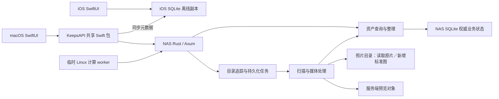

# Keeps 架构

产品导航与能力边界见 [统一服务端资料库](UX_DESIGN.md)。统一采用 HTTP/HTTPS API；macOS 支持显式文件夹导入，逻辑相册尚未实现。

## 唯一运行模式

Keeps 采用一个 NAS 核心服务和两个原生客户端。NAS 是照片索引、整理结果、媒体任务状态和预览对象的权威真源；iOS 使用自己的 SQLite 图库副本直接驱动浏览，网络同步只更新副本。macOS 图库保持在线查询与内存列表缓存，AI 调色工作流由本机 SQLite 持久管理。

客户端使用共享 HTTP API。`chuan_nas` 的正式图库使用原生 SPK，原片路径保持不变，数据库与预览使用独立状态副本。NAS 原生 SPK 是唯一受支持的服务部署方式；旧 Docker 方案已退役，禁止重启或恢复。当前使用局域网入口，部署见[原生套件说明](../deploy/spk/README.md)。

每张逻辑照片必须有至少一份包含其永久身份的有效 XMP sidecar；导入验收按照片身份去重核查，不以文件数替代照片数，数据库或内嵌身份不能代替 sidecar。关联 RAW、HEIF 和导出版本的 sidecar 使用同一照片标识。

“原片”仅指相机直接产出的照片文件，包括 RAW 和相机直出的 JPEG/HEIF，按来源而非扩展名判断。生成图、修改后的照片、编辑导出图和预览图不属于原片，可按对应功能及用户授权修改，但不能覆盖相机原片。原片字节不可变是所有设计与实现的强约束，覆盖 EXIF、XMP、容器结构、像素及 RAW 成像数据；身份补齐和 metadata 修正只写 sidecar 或数据库，不重写、替换或覆盖原片。新生成的派生文件可以写入 metadata，但必须发布到新路径并拒绝覆盖已有用户文件。显式授权的 NAS 持久移动与 DSM 原生回收仍遵循各自操作规则，不因此获得修改文件内容的权限。



## 代码入口与职责

| 目录 | 职责 |
| --- | --- |
| `server/` | 唯一活跃后端：Rust HTTP API、权威查询模型、SQLite、任务和媒体处理。 |
| `shared/` | `KeepsAPI` Swift 包：HTTP 请求、DTO、连接偏好、Keychain 凭据及 iOS SQLite 副本；无事件回放或照片处理。 |
| `macos/` | 统一资料库浏览、选择、筛选、整理表单及服务器来源/任务界面；`LibraryStore` 仅保存 UI 内存状态。 |
| `ios/` | 原生图库、详情与整理交互；`IOSLibraryStore` 从本地 SQLite 查询，`KeepsClient` 在后台同步 NAS。 |
| `deploy/spk/` | NAS 唯一受支持的原生套件打包、启动与配置。 |
| `control_plane/` | 旧 Python 协议、迁移 seed 工具与对照测试；不是第二套活跃后端。 |
| `scripts/` | 客户端打包入口和显式执行的迁移工具。 |

Rust 主要模块：

- `main.rs`：配置、状态装配、监听与停机。
- `api.rs`：HTTP 认证和路由。
- `catalog.rs`：资产查询及数据库事务内的直接修改。
- `jobs.rs`：目录追踪、持久化扫描任务与文件处理记录。
- `media.rs`：原片元数据读取、精确 JPEG 图像指纹与预览生成。照片读取由 `native_metadata.rs` 使用固定版本的 exif-rs fork 与 Adobe XMP Toolkit 完成，视频由 `video_metadata.rs` 使用 ffprobe；未支持的照片格式（包括暂缓的 BAY、K25、ARI）明确报错，不回退 ExifTool。ExifTool 仅保留生成文件的 metadata 写入等既有用途。
- `versions.rs`：照片版本证据、候选查询及稳定默认版本。
- `revisions.rs`：持久化资料库／目录修订树、SQL 变更捕获和事务内祖先传播。
- `store.rs`：数据库连接、业务表初始化和迁移；运行时不维护 ledger 或多源事件协议。
- `previews.rs`：服务端预览对象及签名 URL。

服务端用户任务由 NAS 进程执行，Statig 管理一次性扫描任务的生命周期，SQLite 保存步骤、断点、进度和完整错误。正常路径按顺序完成索引、媒体与浏览图、旧缓存清理和目录修订收尾；任一步失败即停止，不派生补偿任务或自动重试。任务默认按资源的输入版本、处理规格和有效输出复用已完成步骤，不以历史任务成功记录代替资源检查。目录刷新默认普通模式，显式 override:true 只重做元数据；媒体重建只强制媒体步骤，生成标准图使用新的无冲突路径。普通重试不继承 override，媒体重建失败保留仍有效的已发布结果。服务重启将未完成任务标记中断，等待人工重试；已发生文件移动或回收的索引协调仍须完成，不能重放结果不确定的原片操作。扫描执行器空闲时通过条件变量休眠，不巡检照片库。唯一业务定时自动化是用户显式开启的回收站到期清理。

## 客户端边界

macOS 使用标准 Settings scene（⌘,）配置 Keeps Server 的服务地址、资料库和访问令牌；先验证服务鉴权与资产查询，成功后才持久化并切换连接。设置的“来源”页管理服务器目录追踪和手动扫描；主界面顶部的紧凑任务栏每 5 秒读取 `/libraries/{library}/task-status`，仅在后台任务等待、执行或失败时显示；可在主界面展开详情，并一键复制完整错误。任务状态只查询已提交作业，不将缓存、身份或 GC 积压视为后台任务。显示当前步骤，失败扫描可在任务栏明确重试；未发现的文件不虚构总数。任务完成且无错误后自动隐藏。设置不管理 NAS 设备、SMB 挂载或 SSH 登录。

macOS 查询、两端修改及 iOS 修订号检查经过 `shared/Sources/KeepsAPI/KeepsClient.swift`；iOS 离线包任务、下载与导入由共享包的 `KeepsOfflineRebuild` 执行。iOS 浏览查询经过 `KeepsLibraryDatabase`，在 Application Support/Keeps/Catalogs 保存本地 SQLite，服务器、图库及凭据摘要决定文件身份。客户端不生成、上传或回放 ledger，不扫描原片资料库。macOS 显式导入时枚举所选文件夹并上传文件，随后通过批次范围的媒体任务 API 生成并上传两级缩略图及必要标准图；用户发起曝光调整时通过 API 下载指定底片，在客户端解码、测光和生成展示图。

### macOS 无损曝光

每张照片在 NAS 保存独立底片内容版本引用。默认 Sony ARW 使用 RAW，3FR 优先使用同照片可用且非 Keeps 生成的 HEIF，没有此类 HEIF 时使用 3FR，其余选择像素数最大的有效版本；照片组完成索引后绑定，之后扫描不自动换底片。信息界面文件版本右键可更换。底片及原文件不改写；曝光记录和 standard、512px thumbnail、64px browse 保存为独立编辑结果，不占用 NAS 自动生成的原版媒体记录。

Mac 使用 Core Image，仅调整曝光；下载、渲染、上传、提交阶段持久保存在 Application Support/Keeps/ExposureTasks，断网重试和重启均继续同一 requestID。服务端检查 expectedRevision，三个展示对象齐全后原子切换底片、曝光记录与图片描述，更新库及目录修订。已有调整的底片更换在 Mac 重新计算完成后一起提交；冲突保留旧展示，需用户核实后重新操作。还原只清除曝光记录，保留底片。在线图片与 iOS 离线包统一优先使用已提交编辑结果，NAS 不为曝光结果重新编码。任务完成后清理私有下载及渲染文件；跨任务底片缓存尚未实现，渲染器只接收本地文件 URL。

长任务必须显示进度条：有可靠总量时显示真实完成量，无总量时使用线性不定进度并显示当前阶段。移动同时显示用时；导入保留文件及字节进度，后台更新、扫描和目录回收不虚构百分比。

macOS 导入先枚举文件清单；开启去重后逐照片组计算源摘要、匹配实际目标目录中的文件并上传，RAW/JPEG/HEIF 和关联 XMP 保持成组。匹配结果持久化，恢复不重复处理已匹配组；不在开始时计算整批摘要或扫描全图库。

macOS 导入批次、来源只读授权 bookmark 和阶段检查点保存在 Application Support/Keeps/ImportTasks，重启恢复同一批次。上传、NAS 文件提交、元数据索引与缩略图各自显示进度，并行推进；元数据和缩略图显示已完成照片数及固定批次照片总数，同组 RAW/JPEG/HEIF 计为一张，XMP 不单独计数；每组关联照片及 XMP 上传齐全后立即发布和索引，Mac 同时处理已索引照片的缩略图，不等待整个批次上传。只有全部文件提交、索引完成且两级缩略图就绪才报告导入完成。Mac 通过批次租约接管媒体计算，每分钟续期一小时租约，NAS 在租约有效期间跳过关联照片的本地编码，过期而媒体未完成时显示失败，由用户在导入客户端继续；NAS 不再自动接管。文件与任务归属仍由 NAS 校验，客户端不直接修改 NAS 文件。

导入文件发布由 NAS 持久后台任务按完整照片组执行，`POST /imports/{batch}/finish?async=true` 提交，`GET /imports/{batch}/finish` 查询真实已提交文件数。文件发布期间不持有任务数据库锁，分批保存进度后才清理暂存链接；同组文件尚未保存发布进度时，索引器延迟处理，避免未完成照片组被提前索引并影响恢复。服务重启标记中断，客户端明确提交同一批次后继续收尾。旧客户端同步 finish 接口保留。

macOS 来源目录树支持在应用内把单个文件夹拖到目标文件夹中。客户端通过 `POST /libraries/{library}/directories/move-tasks` 提交 `path`、`parentPath` 与 `requestID`，由 NAS 持久任务完成移动及索引路径更新；通过 `GET /libraries/{library}/directories/move-tasks/{requestID}` 查询等待、校验、移动、索引和追踪阶段。macOS 保存任务 ID，断线或重启后继续查询同一任务，成功后重载目录并跟随新的选中路径。右键菜单支持重命名文件夹：同一任务接口追加 `name` 并保持原 `parentPath`，沿用进度、断线恢复和索引同步；名称必须是非空单个路径分量，来源根目录禁止重命名。已有同步 `/directories/move` 接口保留供已发布客户端使用。来源根目录不可拖动，不能移入自身、后代或原父目录；NAS 使用不覆盖目标的同文件系统 rename，拒绝同名覆盖和跨文件系统移动；持久移动记录用于服务重启时恢复索引同步。Finder 不参与此操作，日常照片目录整理优先在应用内进行。

macOS 照片菜单提供“删除所有弃用照片…”。NAS 预览并持久保存全库弃用照片清单，用户输入照片总数后提交同一任务 ID；服务端确认清单与文件身份未变后，逐文件调用 DSM 原生回收并保存进度、对账索引。重启不重放结果不确定的原生调用，客户端断网或重启继续查询同一任务；NAS 回收与图库软件回收站分开，恢复使用 File Station。接口及边界见 [服务端说明](../server/README.md#显式回收所有弃用照片)。

macOS 图库支持 Command/Ctrl+A 全选当前筛选结果（自动补齐分页）、Command 点选、Shift 连选、Shift 配合键盘左右方向键扩选与 Esc 取消选择；目录树保留 AppKit 的多选语义，Ctrl+A 选择已展开的可见目录。全选尚在加载时禁止移动或批量修改，切换查询会取消全选。照片可从全部照片、筛选结果或当前目录拖入目录树的目标文件夹，经 `POST /libraries/{library}/assets/move-tasks` 提交 `requestID`、`assetIDs`、`sourcePath`、`parentPath`，通过同路径 `/{requestID}` 查询持久任务。`sourcePath` 省略时按明确照片 ID 解析当前库已追踪范围内的来源，有值时限定来源目录。NAS 只移动所选范围内照片的有效文件、关联版本和 sidecar，其它目录的副本保留；批量移动先检查所有重名和跨文件系统冲突，逐文件使用不覆盖 rename 与恢复日志，同步照片索引及追踪归属。客户端持久保存任务并在重启后恢复查询，展示阶段、用时与完整失败信息。

macOS 影片在可调整大小的独立窗口中播放。客户端通过受鉴权的版本 `/playback` 接口取得有效期 24 小时、限定资料库／照片／文件摘要的签名 URL，交给 AVPlayer 以 HTTP Range 按需缓冲和跳转，不先下载完整文件或生成本地影片副本。服务端每次读取复查文件归属、追踪状态与源文件身份，使用 seek 和限长流返回 206；原片只读，不做转码。播放器不支持的编码明确报错，地址到期后重新打开影片获取新地址。客户端与服务端需同时具备此接口。

影片窗口支持保留连续时间片段。客户端提交带稳定请求 ID 的裁剪任务并恢复查询，NAS 持久队列使用 ffmpeg 输出同目录独立 H.264/AAC MP4；先确认新资产入库，再将原资产移入 Keeps 逻辑回收站，原文件后续处理沿用回收站规则。裁剪不覆盖原文件；任务失败不回收原资产，关闭客户端不停止已提交任务。

客户端不存在“NAS / 本地”双资料库模式。默认浏览统一资料库；服务器来源目录属于按需展开的辅助视图和服务端管理配置。主图库查询不依赖目录导航成功。客户端无需 SMB 挂载，不能把服务器路径作为本机文件 URL 打开；预览和业务交互均走 HTTP。

用户选择的本地照片文件仅作为显式上传来源，客户端不监听或扫描原片资料库。iOS 本地 SQLite 是 NAS 的只读浏览副本，不是独立业务真源。业务请求使用 HTTP JSON，离线快照包和图片通过 HTTP 下载；当前共用手写 KeepsAPI，尚未引入 OpenAPI 客户端生成器。
客户端允许保留：

- 当前筛选、选择、已加载分页及表单状态；macOS 按查询保存列表内存缓存。
- iOS 持久化完整已同步图库副本：照片、文件路径关系、搜索/筛选字段、隐藏规则、目录导航、预览描述符和同步修订号。
- 服务地址与资料库名称等 UserDefaults 偏好。
- Keychain 中的访问凭据；旧 `ios.sync.*` 偏好继续读取，明文凭据成功迁移后移除。
- 网络图片缓存。缓存不是业务真源，丢失后可重新请求 NAS。

标签库由 NAS 的 `catalog_tags` 持久保存，迁移回填已有照片标签，照片标签写入时自动入库。macOS 仅在点击“自动生成标签”后复用现有 AI 账户逐张分析当前展示图，优先复用库内词汇，并追加到照片已有标签；浏览和扫描不触发生成。

界面上的“修改评分”“保存标签”“移入回收站”直接提交资产 API，并使用服务器返回结果。请求失败显示错误，不切换到本地写入模式，也不排队产生离线业务事件。

macOS 使用 `KeepsAssetCache` 保存已加载列表与游标，最多 20 个查询、10,000 个资产，按最近使用淘汰，切换连接清空；退出应用后重新请求。返回已访问范围先显示缓存再校验目录修订号，全库查询校验库版本。前台每 5 秒核对范围，持续修改中的自动列表重载最多每 30 秒一次，最终版本变化及时刷新。目录导航独立保留 5 分钟更新及显式刷新，全库计数独立使用 60 秒窗口。

iOS 使用独立读取 actor 打开和查询本地 SQLite，图库、目录和后台准备均不在主线程打开数据库；分页、搜索、精选、回收站和目录筛选不访问 NAS。冷启动先显示系统 Keeps 启动画面，再显示可见的本地加载进度与错误重试；返回前台保留已有图库，联网更新不遮挡内容。已有完整本地数据库时立即显示全库布局并允许滚动。首次只准备数据库与时间索引，进度显示在图库内容区域；缺少缩略图使用静态占位图，下载不阻塞交互。启动准备、回到前台及显式更新可以触发同步；图库与目录均不提供自定义上拉刷新。离线修改未实现，整理操作仍由 NAS 确认后更新本地行。

iOS 同步先读取全库 `/revision` 的图库世代与精确提交版本。同世代、同版本且无未完成任务时仅确认副本进度；首次、强制重建、世代变化或增量历史过期时下载完整数据库，其余下载上次版本之后的最终记录与删除标记。`KeepsOfflineRebuild` 复用持久离线包任务和断点下载，SHA-256 校验后将照片、完整路径、目录、隐藏规则和版本原子提交；单条整理响应只更新本地照片，不推进全库游标。本地成功提交后才向 NAS 确认，失败保留旧库和可重试任务，不将下载完成视为同步成功。同步后的全库轻量时间索引在手势与减速结束后更新布局并恢复可见照片位置；数据库提交频率不决定界面刷新频率。全屏查看器仍以时间与 ID 双向 keyset 分页，窗口最多 1,000 条，每页 200 条；点击远处照片按 ID 读取。所有副本替换和清理只操作 SQLite 与同步临时文件，不触碰照片文件。

目录导航（包含空目录）随离线包持久化，由 `IOSDirectoryStore` 从本地数据库读取；普通展开不发网络请求，副本更新后重读已展示目录。切换服务器、图库或凭据打开独立数据库，取消旧请求并阻止旧结果发布。API 请求绕过 URLCache；缩略图和标准照片使用独立媒体缓存。

图片分为小缩略图、标准照片和可选 RAW。网格使用 `thumbnail`（迁移期间可显示旧 `preview`），查看器先小图再加载 `standard`。标准照片直接复用同资产已确认的 JPEG/HEIF，仅缺少已确认标准图的 RAW 由 NAS 生成完整分辨率 HEIF，保留指定拍摄元数据；生成的标准照片放在 RAW 所在的 `/volume2/photo` 对应目录，文件名使用 RAW 同名主干和 `.heic` 扩展名，重名时递增 `.1.heic`、`.2.heic`，不在名称中加入哈希；元数据 `Software` 和 `XMP CreatorTool` 标记为 `Keeps`，登记为同一资产的文件版本，不属于可删除缓存。仅创建新文件，不覆盖已有照片；3FR 暂缓标准图生成，仍生成小图。视频封面先缩到目标尺寸，再从前 60 帧选取代表帧，并以 PNG 中间帧进入 HEIC 编码；旧版视频封面单独重建，照片缓存不受影响。客户端在视频封面上显示播放标志。视频 `standard` 为 null，不把整段视频交给图片解码器。

两端共享 `PreviewCache`，目录为系统 Caches/KeepsMediaV2 下的 browse、thumbnail、standard、preview。小图不设固定总容量上限，可全库保存；标准照片与过渡旧预览分别为 5 GiB LRU，超限回收至 4 GiB。空闲空间低于 1 GiB 时回收当前用途的缓存；小图预取要求超过 2 GiB 空闲空间。升级只清理一次旧专用 KeepsPreviews，标记持久化；系统仍可回收 Caches，因此不承诺永久离线保存。缓存命中按确定的文件名直接读取，首屏不等待全目录扫描；无限容量的小图在空间充足时写入也不建全库索引，仅有限容量或低空间淘汰时建立 LRU 索引。内存成本按解码后的 bytesPerRow × height 计算，四个用途合计 iOS 72 MiB、macOS 288 MiB，按显示尺寸和屏幕倍率下采样。

缓存身份由服务器 URL、资料库、资产 UUID、用途和内容版本组成，不含签名 URL；相同用途身份的并发下载合并，不额外使用 URLCache。链接有效期 15 分钟；仅对 `preview_token_expired` 自动按用途刷新并重试一次，缓存登记实际返回版本。macOS 打开目录时，当前查询范围少于 10,000 张照片则独立分页预取全部两级小图，最多四张并发，只写磁盘缓存；达到 10,000 张则保留随滚动加载。目录、筛选或连接变化取消旧预取，分页跨修订停止；浏览不等待预取完成，仅可见图片解码。macOS 不再自动预取全库。

iOS 的缩略图检查与补齐使用 `ThumbnailPrefetch.runLocal` 遍历本地 SQLite，覆盖隐藏及回收站记录；已缓存文件复用，缺图和失败分别记录。首次数据库导入后立即开放图库，再由后台预取逐项补齐两级小图。常规更新先刷新本地数据库，再补齐缺失小图并更新 iCloud 副本。首次准备使用 `BGContinuedProcessingTask`，常规更新使用短期后台时间及 `BGProcessingTask`；后台任务与 App 内共享阶段进度，取消和连接切换会终止旧任务。后台时机及缓存回收由系统决定，不承诺锁屏后立即完成或永久离线保留，具体准备与恢复流程见下文。

NAS schema 6 增加照片、视频、目录实体表；旧 catalog 保留公共资产查询、版本和整理状态，实体表随其同步，空目录在扫描时入库。`media_cache` 保存源版本、生成规格、pending/processing/ready/failed/cancelled 状态、有限重试和实际对象；现有单 worker 按照片组完成索引、身份、标准图和缩略图；缺失媒体由人工重试进入同一照片更新队列，不自动触发原片扫描。NAS 每次调度处理一组照片，并发 1；临时 Linux worker 有独立的并发与资源上限，共享同一任务状态，不能重复领取 processing 项。缩略图最长边 512px，`KEEPS_THUMBNAIL_QUALITY` 默认 50，纳入规格版本；源变化、丢失、标准文件时间戳变化会重新排队。审计有独立时间字段，不伪造最近成功进度。完整尺寸标准照片编码 watchdog 为 900 秒，缩略图/旧预览仍为 180 秒；内存和线程限制相同。

本地生成失败、远端报错和租约过期时，先按任务源版本核对当前索引：资产已移入回收站或已无有效索引来源则标记 cancelled，退出待办及失败计数；源版本已变化则重新排入当前版本并重置重试次数；仍有效的任务保留完整错误及有限重试。迟到的旧版本失败不得覆盖新任务。来源重新入库后 cancelled 任务可恢复。现有空闲维护每轮只复核一条到期的历史失败记录，不重新编码、不扫描缓存目录、不删除缓存或原片；可读性、权限、磁盘与编码错误不能仅凭失败本身判定任务失效。

schema 8 增加 `remote_cache_tasks`，保存 Linux worker 的领取凭证、输入版本、1800 秒租约及完成状态。Linux 通过鉴权 HTTP 主动领取、下载、续租和上传；NAS 校验后沿用标准图独占发布与缓存登记。完成凭证和缓存 ready 在同一事务提交；断线可重试完成，租约过期回收且最多尝试 4 次。Linux 不直接访问数据库、不挂载照片目录、不对外监听。

schema 9 增加照片根身份映射。照片资产使用固定 UUID，canonical root 一旦建立不再随扫描改变；新确认的外部身份只登记别名。读取内嵌 XMP `xmpMM:OriginalDocumentID`，其次同目录 XMP；已知根身份优先于内容或拍摄匹配。未知根不能仅凭同路径继承旧照片，扫描也不再合并或删除已发出的不同资产 ID。SHA-256 用于字节校验、精确重复判断及具体文件引用，不作为照片 UUID。缺少身份时沿用已确认照片 UUID，新照片生成 UUID，并补写身份 sidecar。所有原片身份统一写入 `原文件名.扩展名.xmp`，不改写原片。同根 ID 的不同内容保留为版本/位置，移动后更新路径并保留资产 ID。生成标准图继承根 ID。数据库仍是评分、标签、路径及任务的真源。

schema 10 增加 `catalog_deprecated_files` 和照片关联索引；目录核对只标记同一照片内部的精确重复，不合并既有照片 ID，不删除或移动磁盘原片。版本 API 返回保留路径及判定依据。当前服务支持 schema 14；版本更旧的服务拒绝打开该数据库，部署前必须核对 schema 并备份双库。

schema 11 增加独立浏览图描述、来源缩略图版本与有限重试状态，不使现有 512px 缓存失效。NAS worker 在人工照片处理步骤中生成标准图、缩略图和浏览图，失败向父任务传播，不再全库轮询补图或定期核对缓存；API 和离线包只发布匹配当前来源的版本。部署前停服备份并显式 migrate。

schema 12 在照片表增加底片引用及编辑修订号，回填已有照片的默认底片；`photo_edits` 保存曝光参数和客户端生成的三种展示图，`photo_edit_requests` 保存幂等提交结果。原片和普通预览缓存保持独立；客户端升级与服务端迁移配套进行。

schema 14 统一既有编辑状态与导入批次逐路径计算租约。兼容 schema 13 的编辑状态版本及导入租约版本，迁移保留配方、已确认决定、展示对象和租约；升级前停服并备份 SQLite，执行现有 `keeps-server migrate`。迁移不改原片，租约与媒体任务跨 NAS 重启保留。


身份 metadata 补写只在用户触发的照片处理流程内执行，不再后台回填。使用进程内 Adobe XMP Toolkit 更新标准 RDF/XML sidecar 的 `xmp:Identifier`（rdf:Bag 中的 `https://keeps.photos/photo/<UUID>`），保留已有第三方字段；专属 sidecar 优先于旧内嵌身份，ID 相同时不重写。原片摘要、版本及缓存引用保持不变，不再因身份补写重新计算原片哈希。新生成的标准图仍可内嵌标准身份。每个文档的 `xmpMM:DocumentID` 与照片标识分离，已有 Adobe 来源字段保持不变；仅有明确来源时建立 OriginalDocumentID/DerivedFrom。真实 metadata 修改更新 InstanceID 与 MetadataDate，相同写入不改变实例。新照片评分和拍摄日期采用标准字段，现有 Lightroom 参数原样保留。应用内评分、标签与调整编辑的数据库写入流程不在此次身份侧写改造范围内。

临时 worker 在数据库事务中从现有状态索引直接领取一个到期 pending 项（LIMIT 1），不做全库优先排序，也不另设内存任务队列。缺标准的 RAW 仍在同一个任务中先生成完整标准图再生成小图，尚未拆为两个独立阶段。默认 4 并发、8 CPU、12GiB RAM、32GiB 临时预算。日常默认 NAS 本地编码开启（KEEPS_LOCAL_CACHE_ENCODING_ENABLED=1），全库远端派发关闭（KEEPS_REMOTE_WORKER_ENABLED 未设或为 0）。Mac 导入批次的有效计算租约允许其独立领取该批次任务，不需要开启全库远端派发。Linux 只在用户明确安排的一次性大规模处理时启用；服务器开关设为 1 后才能领取任务，worker 使用显式 bulk profile，且不自动重启。批量处理结束恢复远端开关为 0 并停止 worker。部署见 [Linux worker](../deploy/linux-worker/README.md)。

schema 18 为缓存清理队列保存照片归属。明确替换的生成对象进入该照片的清理步骤，同步检查所有当前引用后删除；无宽限期、全库清理循环或自动重试，失败保留完整错误。尚被引用、未提交的编辑上传及无法确认照片归属的历史平铺缓存保留。不删除原片或普通标准照片。升级须停服、备份双库并显式执行 `keeps-server migrate`。cache retry/rebuild 仍建立有限的一次性手动作业。

交互 API 使用独立的长期 URLSession，与共享会话中的图片下载分离，避免目录请求和预览争用同一会话的连接调度。目录展开只返回当前层；服务端为每个目录探测是否存在可见直接子目录，遇到第一个即停止，`hasChildren` 返回真实布尔值，叶子目录不显示展开箭头。

macOS 目录树使用 `NSViewRepresentable` 包装原生 `NSOutlineView`，由 AppKit 负责树形行复用、展开折叠及键盘导航；SwiftUI 保留其它界面。目录节点按路径保持稳定身份，数据和展开状态由 `LibraryStore` 管理，Coordinator 仅桥接视图。数据源同步读取内存缓存，异步响应仅更新变化节点；收起再展开不重复请求，刷新保留有效展开、选择和滚动位置，切换服务器才重置。`local.keeps` 的 `navigation` 日志记录目录请求耗时与返回数量，不记录路径或凭据。

路径统一以 NAS 真实绝对路径为身份，例如 `/volume2/photo/照片`。原生套件直接访问照片目录；导航、查询、追踪配置、扫描状态和 catalog_paths 使用同一路径，不使用容器路径别名或 Mac `/Volumes` 路径。唯一照片根为 `/volume2/photo`，`myphoto` 不参与追踪或挂载。历史目录关联可通过 `scripts/migrate_nas_paths.py` 离线恢复，核对文件存在/大小及既有资产记录；恢复不代表重新校验内容哈希。

导航条目包含当前目录 `directPhotoCount` 和递归总数 `photoCount`，客户端显示为“当前数（递归总数）”；旧服务或旧离线缓存缺失当前数时显示“—”，不虚构为零。在线导航与离线包使用同一计数口径，按 `(library_id,path)` 索引范围查询后代路径并对未回收资产去重；不枚举文件系统统计照片、不逐项请求图库分页。目录行在子目录或所选目录内容读取期间显示原生旋转指示，完成后恢复文件夹图标。计数独立于图库筛选条件。

## macOS 文件夹导入

Mac 顶栏“导入”（⌘⇧I）选择本机来源文件夹和已有的 NAS 追踪目录。来源可含子目录；RAW、JPG/JPEG、HEIF/HEIC/HIF 及同目录关联 XMP 默认全部平铺到一个目标目录，不按日期建目录。“保持导入结构”默认关闭；开启后在目标目录保留来源内部的相对子目录层级，不额外套一层来源目录。客户端只读来源，仅开启去重时按块计算 SHA256；排除隐藏项、符号链接、`@eaDir`、`#recycle` 和无关联 XMP。App Sandbox 使用用户所选文件的只读权限。

`POST /libraries/{library}/imports` 接受 `{id,targetPath,preserveStructure,deduplicate,files:[{id,relativePath,size,sha256}]}`，服务器按来源目录与文件主干为 RAW/JPEG/HEIF/XMP 分配不会覆盖已有文件的名称。`PUT .../imports/{batch}/files/{file}` 从请求流写入隐藏暂存并验证字节数和哈希；NAS 在每组 RAW/JPEG/HEIF/XMP 上传齐全后，以无覆盖方式发布 XMP 和照片并提交该组索引任务；`POST .../imports/{batch}/finish` 在所有文件上传完成后提交批次收尾，并返回 `{job}`。批次查询汇总发布、索引及两级缩略图进度，接入现有身份登记、版本判断及媒体处理。导入后按同目录、同主干及完整拍摄元数据规则归组 RAW 与 HEIF。

批次及上传状态保存在 NAS jobs 数据库；同一 manifest ID 重试返回当前状态，已上传文件跳过。Mac 展示文件/字节、元数据和缩略图进度、失败文件和错误；导入开始后禁止关闭面板，暂停或出错时保留面板以继续同一批次，整个批次完成后自动关闭；重启后通过持久批次及只读来源授权继续。上传与 Mac 缩略图处理期间应用须运行，NAS 已接收的完整照片组独立继续发布和索引；Mac 租约到期后 NAS 接管未完成的缩略图。完成提示以整个批次的发布、索引及两级缩略图就绪为准。单批次最多 10,000 个文件，每个文件 1 B–8 GiB。

目录删除确认后，macOS 暂停主窗口、快捷键、设置与任务窗口的其他操作，显示后台阶段和经过时间。客户端持久化任务 ID 和目标连接，超时继续查询，重启恢复同一任务；服务器已接受但记录丢失时提示人工核对，不重新删除。任务成功后刷新目录与图库。

## API 契约

业务路由需要共享访问凭据。首期使用单一 NAS 的 Bearer 认证，不声称具备多用户或租户隔离能力。服务仅接受配置的 `KEEPS_LIBRARY_ID`（默认 `local-library`）；鉴权后拒绝未知图库，返回 HTTP 404 / `library_not_found`，包括空库查询和目录写入。图库 ID 不是 NAS 用户名；合法但尚无照片的图库仍返回成功的空列表。预览下载使用服务端签名 URL。

| API | 用途 |
| --- | --- |
| `GET /libraries/{libraryID}/assets` | 分页查询、目录范围、搜索、评分、旗标、颜色、标签、回收站及排序。 |
| `GET /libraries/{libraryID}/assets/{assetID}` | 资产详情。 |
| `GET .../assets/{assetID}/versions` | 文件版本、路径、可用性和默认版本。 |
| `GET .../assets/{assetID}/edit/versions` | 已发布调色版本历史、前次发布版本、底片文件引用及可用媒体。 |
| `GET .../assets/{assetID}/version-candidates` | 非空拍摄时间、相机、镜头匹配的候选；不是自动合并结果。 |
| `PUT .../assets/{assetID}/default-version` | 指定已有可用版本，body 为 contentHash；入队重建默认预览。 |
| `GET /libraries/{libraryID}/revision?path=...&includeChildren=true` | 省略参数返回资料库单调修订号和 isUpdating；path 指定目录作用域，includeChildren 按需返回直接子作用域的版本与修改状态。仅查索引，不扫描照片或文件系统。 |
| `PATCH /libraries/{libraryID}/assets/{assetID}` | 修改评分、旗标、颜色和标签。 |
| `POST .../assets/{assetID}/trash` / `restore` | 移入／恢复 Keeps 回收站，入站开始保留期限计时。 |
| `POST .../trash/preview` / `POST .../trash/{id}` / `GET .../trash/{id}` | 数量确认后清空 Keeps 回收站，NAS 持久任务通过 DSM 原生接口回收文件并清理图库资料。 |
| `GET` / `PUT .../trash/settings` | `{enabled,retentionDays}`：默认启用、30 天，可调整为 1–3650 天或关闭。 |
| `POST .../directories/trash` | 提交包含 UUID requestID 与完全相同目录名的持久异步任务，202 返回任务；GET 同路径加 /{requestID} 查询 waiting/recycling/reconciling/completed/failed 阶段，重试幂等。后台调用 DSM 原生 `synorecycle --rmdir`，由 NAS 自动管理回收位置和删除记录；不使用手工移动或永久删除兜底。详见服务端 README。 |
| `GET` / `PUT /libraries/{libraryID}/hidden-directories` | 读取和修改目录隐藏标记（path、hidden），返回 paths；仅改 NAS 数据库。 |
| `GET /libraries/{libraryID}/counts` | 全部、精选和回收站计数。 |
| `GET /libraries/{libraryID}/directories` | 服务器索引中的目录及数量。 |
| `GET /libraries/{libraryID}/navigation?path=...` | 服务器真实目录导航；省略路径返回追踪范围内的根入口，指定路径返回直接子目录，包含空目录；仅返回 `path`、`directories`，不再返回位置分区或本地暂存状态。 |
| `GET` / `POST /libraries/{libraryID}/folders` | 查看追踪目录与原片根路径、添加相对目录。 |
| `DELETE /libraries/{libraryID}/folders/{folderID}` | 停止追踪，保留原片。 |
| `POST .../folders/{folderID}/scan` | 提交扫描任务。 |
| `GET /libraries/{libraryID}/jobs` | 任务状态和错误。 |
| `POST .../jobs/{jobID}/retry` | 重试失败任务。 |
| `GET /derivatives/{assetID}?role=thumbnail&libraryID=...` | 按用途刷新签名下载 URL（role 三选一）。 |

分页响应为 `items`、`total`、`nextCursor`、`revision`、`isUpdating`；修订号、修改状态与照片数据来自同一个 SQLite 读事务，有 directory 时为目录子树版本，否则为资料库版本。游标由服务端解释。`capture_desc` 使用 `sort_time DESC, id ASC` 的 keyset 边界，不依赖边界照片仍存在；新增或删除边界之前的照片不改变后续页的位置。新返回游标为 `cd1.` 编码值；为已发布客户端和持久缩略图预取断点接收旧非负数字游标，下一页即升级为 keyset。其他排序仍使用数字偏移。`PATCH` 中省略字段表示不修改，显式 `colorLabel: null` 表示清除颜色。

旧 `/ops`、心跳、归档回执和客户端预览上传路由保持关闭。业务命令直接在 SQLite 事务中修改状态并更新修订号，不再生成 ledger、设备序号、逻辑时钟或归档回执。旧事件仅保留在迁移前数据库备份中。

## 数据与照片安全

- 原生套件状态位于 `/volume2/@appdata/KeepsNativeProbe/production-state`，服务直接访问 `/volume2/photo`。
- `/volume2/photo` 需要写权限用于创建标准照片；任何已有照片、RAW、sidecar 文件都不得删除、移动或以另一张照片覆盖；允许补写身份 metadata，但不得改变像素或 RAW 成像数据。标准图写入须防止重名覆盖。
- 停止目录追踪和移入 Keeps 回收站只改变服务器记录。删除弃用照片先进入 Keeps 回收站；数量确认清空或可调期限（默认 30 天）到期后，NAS 持久任务通过 DSM 原生回收接口处理原片版本和 XMP，全部回收后清理图库资料与生成缓存。恢复取消入站计时，重新入站重新计时；schema 16 迁移时历史回收站照片从迁移当天计时。删除文件夹仍要求同名确认。不永久删除，不自行移动到 `#recycle`。
- 预览写入 `KEEPS_ROOT/previews`。维护生成的预览和缓存不能触碰原片。
- SQLite 是唯一业务真源；数据库 WAL 保留用于事务安全，它不是业务 ledger。schema 7 从已有业务表迁移，禁止通过重放旧事件恢复已移除的目录。数据库备份保存评分、标签和关联；文件备份保存照片内容。历史 Python 工具不属于生产运行时。

历史扫描/ledger 客户端的本地数据库不是新架构中的活跃数据源；新的 iOS SQLite 仅由 NAS API 同步建立。源码移除不删除用户已有数据库或照片；需要导入历史资料时，使用显式迁移工具和验证步骤，不能在新客户端启动时恢复旧扫描、复制或同步任务。

## HTTPS 外网入口

目标入口为同一 Keeps HTTPS 域名，经家庭路由器 TCP 443 转发到 NAS 专用 8443 上的 DSM 反向代理，再转发 NAS 本机 127.0.0.1:2283。域名、证书、路由规则及维护窗口确认后才可应用到现有服务。`CONTROL_PLANE_PUBLIC_BASE_URL` 必须与客户端 HTTPS 入口一致，使签名预览链接也可在外网访问。Keeps Bearer 鉴权不由 DSM 登录取代，原片仍仅由服务只读访问。

这项入口配置不代表外网已上线，NAS 服务部署与验收见 [原生套件说明](../deploy/spk/README.md)。

## 客户端发布

客户端通过 TestFlight 内部测试分发，团队为 ClimaMind LLC（`3TZ6RCL8NE`）。`scripts/testflight.sh` 统一执行两端 Xcode 归档与 App Store Connect 上传；macOS 发布工程为 `macos/Keeps.xcodeproj`，继续复用现有 Swift 源文件与 KeepsAPI，本地 SwiftPM 测试与开发打包保持可用。iOS 使用既有工程，企业导出配置已移除。

macOS 发布构建启用 App Sandbox，只授权出站网络访问，不请求读取用户照片目录。连接凭据继续使用应用私有 Keychain；签名沙盒版本的配置读取与连接需实际安装验收。上传、Apple 处理、分配内部测试组和设备可安装是不同阶段，不能以归档成功代替发布完成。

## 验证边界

- `swift test --package-path shared`：共享 HTTP 路由、编码、分页、错误与服务器返回数据契约。
- `swift test --package-path macos`：客户端 UI 状态、远端交互和品牌资源。
- iOS Simulator 构建：共享包集成和原生客户端编译。
- `cargo test --manifest-path server/Cargo.toml`：服务端协议、存储、查询与任务测试。
- 真机/NAS 验收需要另外验证服务重启、原片只读挂载、任务持续执行、数据迁移及客户端到 NAS 的完整流程；编译或单元测试通过不能替代这些证据。

## Architecture Inventory

```json
{
  "repo_type": "photo_asset_manager_monorepo",
  "active_backend": "rust_nas_server",
  "client_role": "ux_only",
  "business_source_of_truth": "nas",
  "client_business_database": false,
  "client_event_replay": false,
  "client_original_processing": false,
  "client_nas_mount_required": false,
  "transport": "http_json",
  "key_directories": {
    "rust_server": "server",
    "shared_client_api": "shared",
    "macos_app": "macos",
    "ios_app": "ios",
    "legacy_migration_reference": "control_plane",
    "nas_deploy": "deploy/spk"
  },
  "entrypoints": [
    "server/src/main.rs",
    "server/src/bin/keeps-inspect.rs",
    "scripts/merge_tracked_folders.py",
    "server/src/api.rs",
    "shared/Package.swift",
    "shared/Sources/KeepsAPI/KeepsClient.swift",
    "shared/Sources/KeepsAPI/KeepsSettings.swift",
    "macos/Package.swift",
    "macos/Sources/PhotoAssetManager/PhotoAssetManagerApp.swift",
    "ios/KeepsIOS.xcodeproj/project.pbxproj",
    "ios/Sources/KeepsIOS/KeepsIOSApp.swift",
    "deploy/spk/pack.py"
  ],
  "server_modules": [
    "server/src/catalog.rs",
    "server/src/jobs.rs",
    "server/src/media.rs",
    "server/src/versions.rs",
    "server/src/revisions.rs",
    "server/src/store.rs",
    "server/src/protocol.rs",
    "server/src/previews.rs"
  ],
  "original_file_policy": "read_only_no_delete_move_or_overwrite",
  "nas_production_acceptance": "requires_live_verification"
}
```

## 隐藏目录

Catalog schema 2 新增按资料库隔离的隐藏目录标记。升级 schema 1 时需停服备份并显式执行 migrate；保留资产与历史事件。assets 与 counts 默认过滤隐藏内容，showHidden=true 关闭过滤；过滤先于分页和 total 计算。选中隐藏根或其后代时解除该根的过滤，独立隐藏的更深层后代仍需进入后查看。资产有多个路径时，只要包含仍被过滤的隐藏路径就不显示。导航入口仍保留。Mac 提供目录右键标记与菜单开关，开关为本机显示偏好，标记保存在 NAS。该功能属于浏览过滤，不是文件加密或访问控制。

### 持续集成

GitHub Actions 按改动范围验证 Rust 服务、Apple 客户端和 Python 工具；push 范围从上一次成功 CI 计算，PR 使用 merge base，手动运行全部检查。各客户端并行测试，构建缓存按平台和工具链隔离；密钥扫描与发布脚本测试始终运行。无凭据 CI 通过且 macOS 检查实际运行后，独立发布工作流才使用环境凭据归档上传；上传队列仅保留一个待执行构建，Apple 处理等待由另一任务承担。发布构建号沿用 CI run number 加 100，并按同一目标版本和构建号恢复查询。


## 照片版本与持续索引（schema 3）

一个资产可以关联多个文件内容版本，每个版本有多个物理路径；目录查询仍按资产去重。同一直接父目录内，内容哈希相同或具有精确 JPEG 图像指纹的新文件可归入同一资产；匹配证据本身须有该目录路径，不能借历史跨目录资产桥接。已有路径关联保留。JPEG 指纹跳过 EXIF/XMP/IPTC/注释，保留图像编码、方向、颜色空间、ICC 和 Adobe 颜色转换；缩略图哈希不能充当精确图像证据。拍摄时间保留亚秒与显式时区，原始时间文本和机身序列号随版本保存。没有时区时沿用服务时区，歧义时间报错。

新导入以标准 `xmp:Identifier` 中的 Keeps 照片标识为持久身份，数据库与每文件专属 XMP sidecar 保存同一身份；旧 `keeps:PhotoID` 继续读取，不主动迁移或删除。已有身份优先，其次相机 ImageUniqueID、第三方 OriginalDocumentID/DocumentID，再按同一直接父目录的原始文件名主干进行唯一无冲突配对；不明确时创建新照片，不阻塞导入。缺少可用 ID 时按拍摄时间生成带随机部分的 UUIDv7；无拍摄时间时用当前时间生成 ID，但拍摄日期保持未知，并登记 `catalog_missing_capture_dates` 供后续人工校正；补日期不改变 ID。schema 20 保存来源标识映射与待校正日期。索引不再按内容哈希或图像指纹合并，也不逐张执行全目录查重；传输完整性与现有文件版本协议仍使用校验摘要。独立查重时，文件内容 SHA-256 或精确 JPEG 图像指纹相同则只保留一个有效文件，其余写入 catalog_deprecated_files，记录保留路径、判定依据和中文弃用理由；仅标记，不删除、移动或改写原文件。弃用文件不作为有效版本展示或编码来源，详情中单独列出；保留文件消失后重新选择仍存在的副本。元数据一致但主干不同仍只列为候选。schema 10 迁移使用既有索引协调历史关系，保留原片路径、整理信息和身份别名，优先保留成片资产的已有缓存。升级仍须停服、备份双库并显式 migrate。

默认优先级为用户指定、明确内嵌 XMP HasSettings 的非 RAW 成片、其他可渲染格式、RAW。同级选择后保持稳定；候选排序按像素数和哈希决定首次选择，但已经选择的同级版本不会随扫描顺序切换。默认文件全部缺失时改选仍可用版本。没有任何可用原片路径的资产从普通列表和计数排除，按 ID 的历史记录保留；原片恢复并重新扫描后重新可见。更换默认立即使旧预览引用失效，后台从选定原片生成预览；提交预览时再次检查默认内容哈希，拒绝过时任务覆盖。客户端详情可查看版本并指定默认；所选版本须至少有一个仍在追踪的可用位置，否则返回 409 且不修改默认。macOS/iOS 前台每 5 秒检查资料库修订号，变化才刷新，后台暂停，切换连接取消旧请求。

schema 3 显式迁移只创建版本/默认/修订表，不合并、拆分或回填历史资产；已有路径和内容哈希的资产关联保留。历史资产没有版本证据时继续使用原预览。生产升级前停服并备份 catalog 与 jobs 两个 SQLite 数据库，catalog 使用 migrate 显式升级；jobs 打开时添加队列字段并恢复中断任务。schema 3 机制的 NAS 部署证据见部署文档；历史库整理仍单独执行。

扫描只由用户显式触发，SQLite 保存人工任务与断点。添加目录只登记配置；启动、外部文件变化、缺失缩略图和后台维护均不发起原片扫描。用户通过扫描同步外部新增、修改、删除、重命名与 sidecar 变化。任务区分 `file`（单文件）、`directory`（当前层）和 `recursive`（子树），未变化且索引有效的原片按 size/mtime 与 sidecar 状态跳过。显式导入、移动、切换默认版本及重试仍完成各自必需的索引和媒体处理。

导入上传流已验证的 SHA-256 在发布完成后与文件大小、设备、inode、mtime 和 ctime 一起持久化；索引仅在这些状态完全一致时复用摘要，否则重新读取并校验。旧批次缺少发布凭据时仍首次计算摘要。Mac 导入媒体处理使用两个并发任务，进度轮询独立运行，各任务分别保存断点和续租。

元数据查询使用独立 WAL 读取快照；评分、标签等交互短事务在当前原子提交结束后优先获得数据库锁。身份 metadata 的磁盘写入和哈希在锁外执行，以独立来源门闩防止媒体任务领取正在改写的文件。NAS API 使用正常 CPU/I/O 优先级，后台长任务在线程级降低优先级；macOS 全库计数独立刷新，不阻塞照片修订轮询，metadata 修改期间自动轮询让路。

队列保留 `work_class` 以读取历史任务，新工作只由人工操作提交。启动取消遗留非人工扫描，将未完成的人工任务标记中断并保留诊断断点；同类内部按 file、directory、recursive 排序。

照片组包含同目录同主干配套原片，以及数据库已确认的同目录版本；同主干只是共同核对的范围，是否归为同一资产仍由既有身份/版本证据决定。组内完成元数据、身份与版本确认，再准备标准图和缩略图，不响应调度抢占；正常停服等当前组结束。处理前在 jobs SQLite 原子记录组成员，成功后清除标记；强制中断重启时使组内增量文件状态失效并重新排入照片更新，从头核对整组。人工目录扫描仅在组与组之间保存待遍历目录、当前目录、最后完成文件名及计数，随后让出执行权。媒体子进程仍有 watchdog，失败保留错误并有限重试，不删除原片。

跨目录移动仅在内容哈希唯一对应一个既有资产、所有历史同内容路径已确定不存在且新文件真实存在时复用原资产 ID；先登记新路径与版本，再撤销旧路径引用，保留默认版本、用户整理状态和有效缩略图。仍存在的跨目录副本与歧义匹配不会合并。

不运行文件系统监听、周期扫描或后台身份补写。启动只刷新目录导航结构，不扫描照片或补做停机期间的照片索引；照片变化在用户下一次扫描时同步。扫描不删除、移动或替换原片；允许既有身份 metadata 补写，图像像素与 RAW 数据保持不变。媒体缓存生成保留在用户操作对应的照片处理流程内。

验证入口新增 `python3 server/tests/mechanisms_smoke.py`（KEEPS_TEST_IMAGE 指定本地测试镜像），仅在临时目录中验证 人工扫描、JPEG 版本归组、连拍候选、默认切换、外部重命名/删除、重启和只读原片边界。

## 精确提交版本与目录修订树（schema 19）

复用 SQLite/rusqlite，不新增缓存框架。`catalog_version_revision` 现在保存资料库的持久单调序号，不再在每次读取时叠加 ledger 最大序号；`catalog_directory_revisions` 保存目录路径、直接父路径与子树修订号。评分、标签、回收站和默认版本等前台写事务有实际变更时，为每个受影响资料库分配一个序号，并把所有受影响目录及祖先更新为该序号；共同祖先去重，兄弟分支和其他资料库不变。没有变化的扫描、重复评分/标签/回收站状态、重复默认选择和相同预览声明不更新版本。扫描观察时间、随机 snapshot assetID，以及同内容别名的文件名/派生 fingerprint 沿用旧版本证据，避免同一照片多个路径交替扫描造成误失效；真实 EXIF 和 sidecar 元数据变化仍被记录。

批量索引与前台修改采用相同的精确提交版本：每个改变手机可见数据的事务为资料库分配一个序号，受影响目录及祖先同号，共同祖先只写一次。批次内后续提交继续递增，不冻结祖先版本。`catalog_revision_updates` 仅描述任务是否仍在处理；开始、完成或取消任务本身不改变内容版本。版本检查、网络增量批次与界面刷新分别控制，不能用降低版本精度实现节流。

用户任务成功、失败或取消时直接释放该任务的目录修订 owner；共享目录仍有其他任务时保持更新中。启动只对已终止的遗留 owner 做一次索引状态收尾，不再通过定期静默窗口维护目录状态。

数据库 AFTER 触发器比较 OLD/NEW 列，只把有变化的资产、旧/新路径或隐藏配置记入 `catalog_revision_dirty`。现有服务器写事务在 commit 前统一 flush；失败时数据、脏标记和修订号一起回滚。路径删除保留旧分支的修订记录，避免客户端一直缓存消失的内容。隐藏规则会影响同资产的其他路径，因此隐藏/取消隐藏同时更新这些关联分支。预览的内容、位置、尺寸和删除也参与版本传播，纯审计事件序号/预览声明时间不参与。

默认 `/revision` 返回 `{ "revision": 123, "generation": "<UUID>", "isUpdating": false }`；指定 path 则追加规范化的 `path`。`includeChildren=true` 追加 `children: [{ "path": "/photos/year", "revision": 123, "isUpdating": false }]`，默认不枚举子作用域；资料库根的直接子作用域为已索引的 `/`。path 必须是绝对规范路径，尾部斜线会去除；非法路径返回 422。尚未索引的合法目录返回版本 0。children 包含历史路径作用域，不保证该目录当前仍存在，不能替代真实目录导航。

客户端可先核对资料库版本，再按需核对已缓存的目录版本，版本变化或 isUpdating=true 时重新查询照片；isUpdating=true 的响应不能作为稳定缓存，即使 revision 相等。保存新列表时使用列表响应自身的 revision 和 isUpdating。筛选、排序、分页与 showHidden 等参数仍属于客户端缓存身份，不能只以版本号作为缓存 key。Mac 使用 KeepsAssetCache；iOS 使用完整图库 SQLite 副本与全库同步修订号，详情见上方客户端数据契约。

手机目录结构保存为 catalog 中的持久投影，首次初始化及显式追踪、目录操作、扫描收尾负责更新；目录结构变化也发布精确修订。离线全量和增量包从同一个 SQLite 读快照取得照片、路径、隐藏规则、目录结构及照片计数，不在打包过程中重新枚举磁盘目录。在线目录浏览仍可读取文件系统，外部未扫描的改变不会自动成为手机同步数据。

schema 3 升级到 4 需要沿用停服、备份、`keeps-server migrate` 流程。迁移一次性从现有路径建立目录祖先索引，把库序号设为旧协议值加一，以保持单调并让旧缓存失效；保留照片数据、版本证据与 ledger。schema 4 不可直接用旧服务器打开，回退必须恢复升级前数据库。停服离线维护脚本的直接 SQL 由持久触发器捕获，服务器启动时在监听 HTTP 前统一发布遗留变更；不支持运行期间绕过 Store 直接改库。schema 4 升级到 5 增加持久批次状态和序号分配表，保留当前修订号；同样需要停服、备份和显式迁移。合并工具接受 schema 3/4/5。

schema 19 增加最终状态同步索引、删除标记、目录投影、图库世代和副本确认表。上线沿用停服、备份及显式 `keeps-server migrate`；已有手机副本首次通过完整快照建立世代与确认水位，后续使用增量。回退需恢复升级前数据库。

## 同目录批量整理

`scripts/merge_tracked_folders.py` 是显式离线维护入口，plan 用生产双库只读快照与实际只读挂载交集逐层检查，apply 要求服务停止、自动备份、核对计划未变化，并跨 catalog/jobs/维护审计数据库原子提交。只合并同直接父目录的精确内容重复；元数据相似、用户字段冲突、历史跨目录资产和未完整索引的目录单独报告。

媒体证据由 `server/src/bin/keeps-inspect.rs` 通过逐行 JSON 提供，复用服务端媒体读取器；不打开业务数据库、不生成预览。检查断点缓存、计划和合并映射位于 KEEPS_ROOT/maintenance。所有原片保留，旧 ledger 不改写；只回放历史 ledger 不能还原离线合并，恢复需双库备份和作业记录。具体规则、命令和回滚说明见 [批量整理](folder-merge.md)。

### iOS 照片浏览实现

iOS 主图库由 SwiftUI 包装 UIKit `UICollectionView`，使用自定义虚拟布局、cell reuse 与 `UICollectionViewDataSourcePrefetching`；不使用 PhotoKit，照片仍来自 NAS 与本地 SQLite。`KeepsLibraryDatabase.timeline` 查询完整筛选结果的 ID、日期、图片描述符、文件名与精选标记，不解码完整资产。`KeepsTimelineGeometry` 支持单张、3、5、9 列：方格位置直接计算，原比例布局预计算行高度并二分查找视口，只为附近照片创建布局属性。网格从开始就覆盖完整图库，滚动与日期定位不读取中间分页；完整索引随图库规模增长，详细资产、cell 与解码图片保持有界。滚动偏移不写回 SwiftUI，日期栏仅在可见日期改变时更新。

图库保持最新照片在底部、更早照片在顶部，右侧日期定位条可直接拖到全库任意位置。同步、筛选或布局变化以可见照片 UUID 和距视口的像素距离恢复位置，普通滚动不替换数据窗口。四档缩放与方形／原比例样式独立，支持捏合、点击、长按菜单和照片详情。快速滚动及附近预取只读取本地图片，离开视口取消尚未完成的读取/解码；缺图不沿途启动网络请求，停下后可见照片再走正常补图路径。网格先显示 64px 浏览小图，停下后按屏幕像素尺寸补清晰图，已有清晰图不降级。浏览小图由 NAS 从已有 512px thumbnail 生成最长边 64px、质量 50 的 HEIF，以 browse 用途全库缓存；客户端不再生成 JPEG。加载中、生成尚未完成和读取失败使用同一张共享静态占位图，不切换转圈或错误图标。图库及目录不提供自定义上拉刷新，底部仅保留悬浮栏固定空间；启动只以本地数据库可用性判断图库是否就绪，已有数据库可离线浏览占位网格。

iCloud 仅使用 Keeps 的私有容器 `iCloud.com.hechuan.Keeps`，不接入 PhotoKit。活动 SQLite 和浏览缩略图仍在本机；`KeepsCloudReplica` 把 SQLite backup API 生成的一致性单文件快照及按版本标识的缩略图交给 iCloud Documents 同步，使用 `NSMetadataQuery` 发现云端占位、`NSFileCoordinator` 协调读写。容器 namespace 按 NAS 地址与图库 ID 分隔，不含访问令牌；非敏感连接信息通过 iCloud key-value storage 恢复。仅空白本地数据库可导入云快照，缺失缩略图先从云恢复，再由 NAS 补齐；已有文件复用，不删除原片。相同或更旧的本地 revision 不覆盖现有云快照。系统上传完成状态不能由本地 stage 完成代替。

NAS 离线重建由 `POST /libraries/{library}/offline-rebuild` 创建任务，读取独立 SQLite 一致快照，在 NAS 本地生成客户端数据库、完整相册目录及已有有效缩略图，发布不可变 USTAR 文件。包内 `thumbnails/` 保存普通预览，`browse-thumbnails/` 保存快速浏览图，清单分别记录已有和缺失数量；iCloud 副本也保存两级图片。快照包含隐藏和回收站记录，以读取时点的 revision 标识，不依赖全库静止或 `isUpdating=false`。iOS 只查询任务进度并连续下载一个文件；失败后以 Range、ETag 和已落盘字节恢复，SHA256 与清单验证通过后导入本地库，失败保留旧库。不再由 iOS 逐页拉取照片或逐目录重建。首次启动请求数据库包以尽早显示布局，显式强制重建可包含缩略图；日常同步使用 formatVersion 2：请求携带 replicaID、generation 和 sinceRevision；同世代的有效副本下载最终状态增量，包含变更照片的完整记录与路径、删除标记及完整目录和隐藏规则，复用本地缩略图并补齐新增图片。旧客户端仍取得完整快照。数据库重建成功与全库缩略图齐备分别判断；NAS 尚无缩略图的记录保留缺图状态，不阻塞已正确建立的离线库。缩略图缺失不阻塞进入图库：可见照片自行加载，后台预取补齐全库两级缩略图。首次 iCloud 恢复也只等待数据库，不等待云端缩略图。数据库导入与图片完整性分开判断，图片失败不回退已导入数据库。准备过程提供暂停与继续。

每份安装的图库副本使用独立 replicaID，NAS 记录已交付与已确认版本及 30 天租约。客户端事务提交成功后调用 `/libraries/{library}/replicas/{replica}/ack`；确认失败可重试，不重新下载已提交内容。服务端按有效副本确认水位回收删除标记，超过保留期限也可推进增量下界；失效副本必须重新取全量。离线包按副本限制保留数量并按期限清理，确认后删除已应用包。全量导入协调关闭所有本地连接后原子替换文件，增量提交后 checkpoint，避免反复把完整数据库写入 WAL。NAS 通过套件备份钩子恢复数据库时生成新 generation 并清空副本登记，手机不能仅凭相同版本号跳过同步。

前台开始的首次准备使用 `BGContinuedProcessingTask`，常规更新使用短期后台时间及 `BGProcessingTask` 调度，后台流程包括数据库、缺失缩略图和 iCloud 副本。常规同步由应用持有，不随 SwiftUI 场景进入后台而取消；短期后台时间到期才取消等待、校验或导入。iOS 离线包由固定标识的后台 URLSession 下载，系统挂起或重启后接管原下载；应用取消等待不取消系统传输，用户主动暂停或切换连接才暂停传输并保存续传数据。前后台接管等待旧任务退出后再写库；回到前台自动沿持久化 NAS 任务、后台下载与已落盘字节继续，主动暂停仍须点击继续；首次数据库包导入后即可滚动，图片由后台预取继续补齐。系统任务和 App 内显示同一阶段进度。系统决定后台运行时机；手动强制退出不保证继续执行应用代码。

`IOSPhotoViewer` 读取有界浏览窗口，并在两端触发本地分页；信息表单以 sheet 呈现，`IOSZoomablePhoto` 使用 UIKit `UIScrollView` 承载共享预览。多选仍使用逐资产 PATCH / trash / restore API，无新增服务端接口。macOS 保留现有等高行布局。iOS 部署目标为 26，浮动控件使用原生 Liquid Glass。

`IOSCollectionsView` 与 `IOSDirectoryBrowser` 从 `IOSDirectoryStore` 读取本地持久化目录导航。`IOSRootView` 把当前数据库与同步动作传给目录 store，数据库更新后重读已展示目录；首次无副本时等待同步，普通目录展开不访问网络。目录页与主图库使用同一个 galleryPage，目录路径进入本地 SQL 过滤。顶部标题与网格纵向排列，目录面板为网格 top overlay，不压缩照片视口；浮动控件位于各自导航页面。

顶部导航采用 `safeAreaInset` 与 `ultraThinMaterial`，网格使用系统 `backgroundExtensionEffect()` 向安全区域延伸背景；该效果不改变实际照片视口，也不把目录菜单纳入网格布局。API 依据：[Apple backgroundExtensionEffect](https://developer.apple.com/documentation/swiftui/view/backgroundextensioneffect())。

目录面板以 ScrollView 内容的实际高度决定尺寸，最大为照片视口高度；超出时滚动并留出底部浮动导航避让空间，保持全宽直角磨砂覆盖效果。`ios/Package.swift` 提供图库与目录状态模块的宿主测试，`swift test --package-path ios` 验证本地启动、离线查询、同步跳过、失败保留和连接隔离；SQLite 查询及持久性在共享包测试。

### 本地 AI 调色验证工具

`macos/ColorTools` 是独立原生 Swift helper（已接入 macOS 设置验证和图库单张/多张调色），固定调用 darktable 5.6.2 CLI。模型经 stdio MCP 读取预览/区域裁切，设置绝对参数、比较不可变候选并选择结果；配方适配层负责 XMP 模块版本、顺序和局部蒙版。原片只读复制到任务私有目录，候选按操作 ID 幂等落盘；每次从固定 baseline 重建，不累积改写原片。RAW 验证支持曝光、源白平衡 RGB 倍率、sigmoid、饱和度及渐变/椭圆局部曝光；JPEG/HEIF 保留原生色彩管线，当前支持曝光与饱和度，工具按输入返回可用参数；几何蒙版仅支持方向为 1 的底片；人物/背景/天空语义软蒙版通过 darktable 原生 rasterfile 接入，支持 EXIF 1–8 方向，物化时还原传感器方向。人物与背景调用 Apple Vision，天空使用固定校验和的 MIT SkySegSmall Core ML 模型。AI 先查看遮罩再引用 maskID；完整 PNG 内嵌配方支持异目录重放，模型上下文及历史摘要不重复传输像素。每张蒙版最多 512 KiB/2048px，配方最多 8 张蒙版和 12 MiB，工作台同步总量最多 64 MiB；过大明确报错并保留本机草稿。天空分割可能误判建筑/云纹理，不能把返回蒙版当作质量保证。NAS 只保存客户端上传的结果与配方，不执行调色。

专用 Skill 位于该包 `Skills/keeps-color`。`scripts/evaluate_ai.py` 仅供开发验证，显式指定 Codex、helper、darktable、输入和全新任务目录，默认 GPT-6 Luna；禁用通用 shell、插件及外部应用工具，只加载本地调色 MCP，保留事件与结构化结果，并核实模型所选候选确实已渲染。此脚本必须显式提供专属 `--codex-home` 和 `--account-email`，拒绝默认开发者目录及不匹配的账户，不继承环境中的 API 凭证。渲染测试通过 `KEEPS_TEST_DARKTABLE` 和 `KEEPS_TEST_RAW` 指定本机输入，未配置则跳过真实 RAW 集成测试。

macOS「设置 → AI 修图」提供运行环境检查、指定邮箱登录、退出、连接测试与内置公开 JPEG 样片验证。原生 Swift runner 只调用应用 `Contents/Helpers` 内的 Codex、helper、darktable；Skill 位于 `Contents/Resources/AIEditing`，不搜索系统安装，不回退到开发账户。认证与日志位于 Application Support/Keeps/AIEditing；Codex 使用其中的独立 `codex` 目录、file 凭证和强制 ChatGPT 登录，每次请求核对实际邮箱。首次 OAuth 授权由用户在浏览器完成，登录状态可在应用重启后重新读取。设置中的公开样片测试仅生成本地候选。图库信息按钮下方和信息面板底部提供 AI 调色入口，选中照片直接追加到这台 Mac 的单例工作台，按待处理照片身份去重，原有版本与进度保留，新增照片自动调色。新增照片保持图库显示顺序；照片调度、下载、AI 会话、上传和本地渲染使用工作台行位置作为优先级；等待请求通过最小堆选出最靠上的照片，后来入队的上方照片优先于已等待的下方照片。正在执行的调用不抢占，失败照片不阻塞后续。客户端有限并发处理，照片任务、AI 会话、本地渲染、下载、上传上限均可在设置中调整（1–20，默认 20/20/2/2/2），每批启动时固定上限，调色工作台原地替换图库；横竖图按接近的预览面积展示，原图与候选保持相同尺寸，极端比例受窗口宽度与预览高度限制。取消和完成位于底部，存在运行或待处理后台决定时禁止返回图库；取消保留草稿，全部逐张决定处理成功后完成并返回图库。每张使用独立 Codex 进程与任务目录；darktable 与展示图生成共用跨进程优先渲染队列和文件锁名额，预览、完整尺寸导出和缩略图遵循同一照片优先级；协调锁下只有等待堆顶可领取名额，取消及进程退出自动清理等待请求并释放名额。任务阶段、耗时与逐张 requestID 持久化，网络故障等待重连、重启继续、已提交请求幂等确认；单张失败不阻塞其它照片，AI 暂时失败触发会话退避。失败暂停时允许重新登录，取消保留已提交结果。每次 AI 运行实时记录脱敏 JSONL 及本地每日用量账本，以运行 ID 和事件行号去重并恢复未完成记录；失败用量计入，缺失用量标为未知。美元金额采用记录时的模型费率快照，明确为 Standard 短上下文 API 等价估算，不代表登录账户账单。工作台先使用图库缓存展示调整前照片，并独立保存当前 standard 快照作为调整前版本；该快照只用于对比。首次 AI 调色读取底片且不继承已发布配方，本地预览后台解码。每次 AI 调色只观察调整前照片并设置一次参数，生成预览后直接返回 ready，不比较效果、不自评；中文调色说明只解释观察依据、用户意图和参数选择目的，不宣称已检查调整后的效果或推荐采用版本；AI 工具不提供版本比较或采用接口，调整后预览只向模型返回完成记录。每张调色结束独立进入待确认，展示调整前和候选预览及调色说明；可以选回调整前、切换候选或追加单张要求。AI 标为 needs_review 的候选保留配方并允许人工采用，确认后由本地 helper 导出全尺寸，不重新调用 AI。继续调色从同一底片实际应用所选完整配方，不在输出图上累积调整。只有用户明确确认，客户端才生成 standard/thumbnail/browse 三图，经 revision 校验原子提交后更新图库；原片不变。发布与弃用使用独立调度名额，不等待其余照片调完；用户采用或弃用后该照片立即从工作台移除，后台进度仅显示在底部状态栏；成功静默刷新图库，失败才恢复到工作台并提供逐张重试。弃用只设置 rejected 标记，不删除文件。选择调整前只保存确认意见和幂等历史，不改变媒体。每版调色说明、用户要求、偏好快照与最终配方 metadata 一起保存；说明不作为用户偏好输入后续调色。

AI 工作台、候选版本、对话、进度和审美偏好保存在本机 Application Support/Keeps/AIEditing/batches/workspace.sqlite，只属于创建它的 Mac，窗口关闭和重启可恢复。SQLite 分表保存工作台、照片阶段与队列顺序、候选和偏好；阶段检查点按照片独立事务提交，采用/弃用先保存决定再静默发布，WAL 与 FULL 同步保证提交原子性。结果图片与运行日志仍保存在任务目录。首次打开会将旧 batch.json 和 preferences.json 一次性事务导入，旧文件保留但不再读写；初始化标记与数据同事务提交，失败可重试，不用旧 JSON 回退覆盖已完成状态。数据库写入失败立即停止工作流并保留完整错误。每张开始时固定偏好版本，追加照片采用开始时的本机偏好；继续调色保留该照片上下文。长期偏好默认只读，通过双击或编辑按钮打开固定尺寸对话框，底部始终显示取消和确认保存；新增照片要求统一写入审美偏好，旧工作台要求在加载时并入偏好并清空独立要求，已开始照片的上下文不变；单张继续调色在独立对话框中确认后提交。同次 AI 调色可从用户明确的调整要求中提炼最多三条可跨照片复用的偏好候选，没有足够依据时返回空数组，不把 AI 自己的建议、局部修正或单图数值当作长期偏好。SQLite schema 2 独立保存候选、来源与接受/忽略状态，跨照片去重，清空工作台不丢失候选；用户可编辑并确认加入，只有此时偏好版本才递增，已开始照片的偏好快照不变。单张对话不会自动改变长期偏好。旧本机工作台迁移保留任务 ID、候选和已确认决定，未确认的旧上传任务仍回到待确认。NAS 不提供工作台或偏好同步接口，schema 13 历史表与已有记录保留但不参与流程；无需为这次边界调整修改 schema。确认发布时才提交成片、配方、调色意见和偏好快照，选择调整前通过 `assets/{asset}/edit/decisions` 记录决定。多台 Mac 的工作台相互独立；最终发布沿用照片 revision 校验与 requestID 幂等，冲突保留本机结果并明确报错。其他设备和离线包只读取已发布编辑展示图。

Release 归档要求显式 `KEEPS_CODEX_BINARY` 与 `KEEPS_DARKTABLE_APP`，固定公开 Codex 0.161.0 和 darktable 5.6.2；缺少组件或签名身份即失败。当前 AI 发行包仅支持 Apple Silicon。构建记录版本/摘要并从内到外签名，子进程继承主应用沙盒；保留上游许可及对应源指向，绝不复制登录凭证。没有运行时输入的普通 Debug/CI 包显示组件缺失。

运行验证使用安装包内置的公开 CC0 风景 JPEG（Nick West，Landscape），许可与来源随图打包。设置流程只读取该资源，不访问用户照片库，不依赖 NAS 或样片下载缓存。资料库版本下载接口保留为受鉴权的通用只读 API，校验资产归属、追踪路径与文件状态。

macOS 单图工具栏提供裁剪与 90°／180°旋转，图库右键旋转针对点击目标。几何调整使用当前完整 standard 成片，不从底片重新测光，保留现有 AI 配方或曝光值；复用三种 HEIF 展示图生成及现行编辑提交接口，不改变 schema 13。任务阶段和修订快照保存在本机 Application Support/Keeps/GeometryTasks，断线或重启继续同一 requestID，裁剪加载前后核对修订并在保存时检查版本。每次操作作用于当前展示图并重新编码 HEIF；原片不改写，已有调色配方不增加几何参数。底片引用及原片仍须可用，以满足服务器提交校验。


文件版本在既有 evidence 中保存独立 `versionID` UUID，重扫保留；生成标准图记录 `sourceVersionID`。历史记录在下一次显式处理时补齐，未处理时返回 null，读取 API 不改库。旧 contentHash 参数继续作为文件校验引用。已发布调色版本复用 `photo_edit_requests` 的提交 UUID 作为独立版本 ID；照片 UUID 固定，当前 `photo_edits` 仅是展示指针。提交回执保存版本 ID、前次发布版本 ID、底片文件摘要与时间，前次发布关系不冒充实际像素来源。替换或重置当前调色不回收历史成片，缓存 GC 保护成功提交回执中的媒体引用。旧版已被回收的文件保留记录并报告 unavailable，不伪造恢复。Mac 在生成的成片及缩略图计算摘要和上传之前，写入 XMP `OriginalDocumentID`（照片根 ID）和 `DocumentID`（此次发布 UUID），无损复制编码图像；重试相同 metadata 不改写文件。SHA-256 继续校验实际上传字节，版本缓存描述保持现有格式。

### macOS AI 筛片助手

图库「AI 调色」下方的「AI 筛片」从当前服务器目录启动，可包含子目录或恢复本机进度。独立分页固定完整目录清单，沿用隐藏目录设置并排除回收照片与视频；分页期间修订变化或更新中则停止，不使用部分清单。按拍摄时间每批最多 24 张，使用内置 Codex 与专属账户，以全尺寸来源缩至最长边 1600px 的图像分组，并给每张照片弃用建议和必填的 1–5 星。允许整组弃用；输出必须完整覆盖本批，拒绝重复、遗漏、越界或非法评分。用户可在卡片、放大和曝光检查中修改留用、弃用与星级，再次点击当前标记取消为无标记；AI 不选择留用；原始 AI 建议以蓝色单独展示，人工修改不覆盖建议；点击「下一组」时默认采用未修改的 AI 建议，人工修改优先；通过既有资产 PATCH 同时保存 picked/rejected/unflagged 与评分，不移动或删除原片。保存成功后才切换组；保存失败保留当前组重试。AI 判断基于缩小后的输入，不承诺原片级对焦判断。

当前组加载全尺寸文件，默认另预载后续 6 张，可选 0、3、6、12、24 张，并发下载最多 2。优先当前 standard，否则读取可用原片版本；哈苏优先相机 HEIF，无 HEIF 使用 3FR。下载原片校验摘要，缓存按服务器、图库和凭据隔离；卡片从同一全尺寸文件解码最长边 1024px，放大按原生尺寸解码，缩略图仅作加载占位，显示「非全尺寸」小标识，全尺寸来源载入并显示后隐藏。全局曝光只改变临时预览。照片大小连续调整，顶栏只保留紧凑控件和偏好编辑入口。

长期偏好独立保存于本机；编辑长期偏好或本次要求同步更新当前筛片会话，后续 AI 分析使用新内容，不从人工改选推断偏好。清单、AI 建议、人工选择和待提交决定以原子 JSON 保存于 Application Support/Keeps/AICulling，按服务器、图库及凭据摘要隔离。确认前持久化决定，逐张记录服务端完成进度；暂停、断网或重启后继续未完成提交，批量提交不具备跨照片原子性。旧会话迁移保留已有评分、人工选择及已确认的待提交决定。持久化失败停止操作；筛片期间阻止同一应用的其它图库修改和调色启动。

单张曝光检查只读下载并校验源文件，RAW 使用 Core Image 线性解码至最长边 1600px；自动展开暗部并叠加用户曝光。该操作不调用 AI、不上传媒体、不提交编辑；关闭检查清理临时副本，换组清除临时参数。非 RAW 文件只展示已有信息，不宣称恢复已剪切细节。
